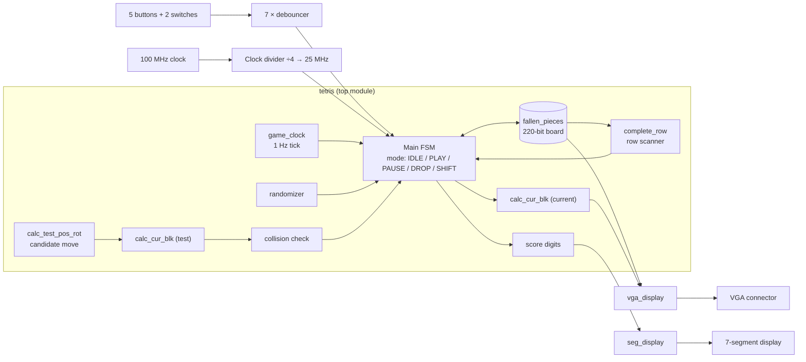
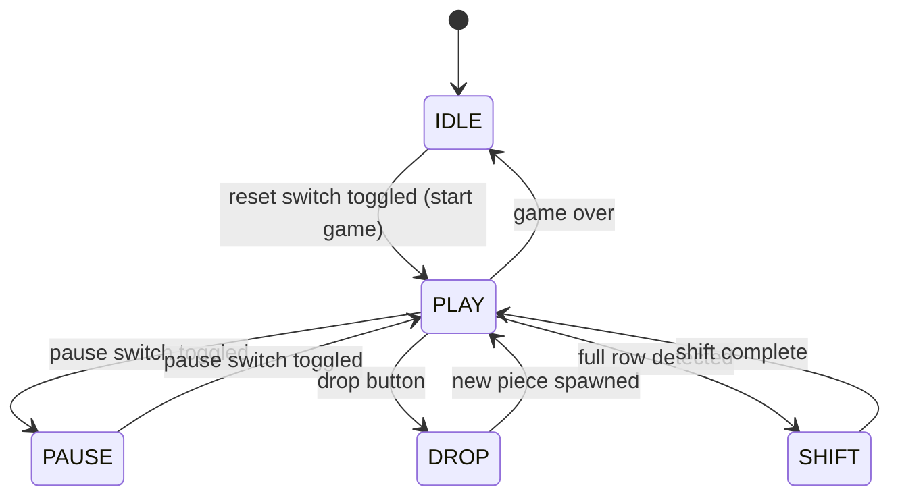

# BlockFall — Hardware Tetris Engine with VGA Output on FPGA

A complete Tetris game implemented **entirely in hardware** in a single Verilog design — no processor, no soft-core, no firmware. The game logic is a finite-state machine plus registers and combinational logic, driving a **640×480 VGA display** and a **4-digit seven-segment score display** on a Digilent **Nexys 3** (Xilinx Spartan-6) board.

**Keywords:** Verilog · Xilinx ISE · FSM design · VGA · FPGA prototyping · Nexys 3 · Spartan-6

---

## Table of contents

1. [Features](#features)
2. [Repository contents](#repository-contents)
3. [Hardware and software requirements](#hardware-and-software-requirements)
4. [Quick start](#quick-start)
5. [How to play](#how-to-play)
6. [Architecture](#architecture)
7. [Module reference](#module-reference)
8. [Design details](#design-details)
   - [Clocking and timing](#clocking-and-timing)
   - [Board representation](#board-representation)
   - [Piece geometry](#piece-geometry)
   - [Movement and collision detection](#movement-and-collision-detection)
   - [Game FSM](#game-fsm)
   - [Row completion and line clear](#row-completion-and-line-clear)
   - [Piece selection](#piece-selection)
   - [Input debouncing](#input-debouncing)
   - [VGA output](#vga-output)
   - [Seven-segment score display](#seven-segment-score-display)
9. [Pin mapping](#pin-mapping)
10. [Customisation](#customisation)
11. [Simulation notes](#simulation-notes)
12. [Known limitations](#known-limitations)
13. [Possible extensions](#possible-extensions)
14. [Troubleshooting](#troubleshooting)
15. [License](#license)

---

## Features

- **Complete Tetris gameplay:** seven tetrominoes (I, O, T, S, Z, J, L) with rotation, left/right movement, soft drop, hard drop, pause, line clearing, scoring, and game-over detection.
- **No processor:** the whole game is described in Verilog as an FSM, registers, and combinational logic. Everything runs in parallel on one 25 MHz clock.
- **Mode-based FSM** with five modes: `PLAY`, `DROP`, `PAUSE`, `IDLE`, and `SHIFT` (row removal).
- **Combinational piece-geometry and collision logic** for all seven tetrominoes in all of their orientations; each candidate move is tested in a single clock cycle.
- **Row-completion scanner** that examines one board row per clock cycle, with **line-clear shifting** that compacts the board.
- **VGA 640×480 @ ≈60 Hz** generated from a **25 MHz clock** divided from the board's 100 MHz oscillator. There is no frame buffer: each pixel's colour is computed on the fly from the game state.
- **Debounced inputs:** all five push-buttons and both switches pass through a debouncer with edge detection, so one press produces exactly one action.
- **Multiplexed four-digit seven-segment display** showing the score (lines cleared, 0–9999).
- 220-bit board memory (1 bit per cell) held in ordinary registers; no block RAM or IP cores are used.

---

## Repository contents

| File | Description |
|------|-------------|
| `tetris.v` | The complete design: all modules in one Verilog source file. Top-level module: **`tetris`**. |
| `cons_file.ucf` | Xilinx User Constraints File: pin assignments for the Nexys 3 and the 100 MHz clock timing constraint. |
| `README.md` | This document. |

---

## Hardware and software requirements

**Hardware**

- Digilent **Nexys 3** FPGA board (Xilinx Spartan-6 XC6SLX16)
- VGA monitor and VGA cable
- USB cable for programming (Micro-USB on the board)

**Software**

- **Xilinx ISE Design Suite 14.x** (synthesis, implementation, bitstream generation, ISim simulation)
- A programming tool for the Nexys 3: Digilent **Adept**, or ISE **iMPACT**

> Other Spartan-6 boards can be used if you change the pin assignments in the `.ucf` file and have a 100 MHz input clock.

---

## Quick start

1. **Create an ISE project** targeting the Nexys 3 device (Spartan-6 **XC6SLX16**, package **CSG324**, speed grade **-3**; check the label on your board revision).
2. **Add sources:** `tetris.v` as the design source and `cons_file.ucf` as the constraints file.
3. **Set the top module** to `tetris`.
4. **Synthesise → Implement Design → Generate Programming File** (this creates `tetris.bit`).
5. **Connect** the board to the PC over USB and a monitor over VGA, then power the board.
6. **Program** the FPGA with `tetris.bit` using Adept or iMPACT.
7. On power-up the monitor shows the empty board (with a test piece visible) and the score reads `0000`. **Flip the reset switch** to start the game.

---

## How to play

### Controls

| Control | Port | Nexys 3 control | Action |
|---------|------|-----------------|--------|
| Left button | `btn_left` | BTNL | Move piece one column left |
| Right button | `btn_right` | BTNR | Move piece one column right |
| Up button | `btn_rotate` | BTNU | Rotate piece 90° clockwise |
| Down button | `btn_down` | BTND | Soft drop: move down one row per press |
| Centre button | `btn_drop` | BTNS | Hard drop: piece falls to the bottom immediately |
| Pause switch | `sw_pause` | SW0 | Flip in either direction to pause / resume |
| Reset switch | `sw_rst` | SW7 | Flip in either direction to start a game (from idle) or return to idle (any time) |

Each button press produces **one** action (holding a button does not auto-repeat). The two switches react to **either edge**, so they behave as toggles whichever position they start in.

### Rules

- The board is **10 columns × 22 rows**.
- Pieces appear at the top (column 4) and fall **one row per second**. The fall rate is constant (there are no levels).
- A piece locks in place when it can no longer move down; a new piece then appears.
- **Completing a row** removes it, shifts everything above it down by one row, and adds **one point** to the score.
- The score is the number of rows cleared and is shown on the seven-segment display (maximum 9999).
- **Game over:** if a new piece cannot appear because it overlaps locked blocks, the game returns to idle and the final board stays on screen. Flip the reset switch to start a new game.
- Rotation is clockwise and is refused if the rotated piece would leave the board or overlap locked blocks (no wall kicks).

### What you see on screen

| Element | Colour |
|---------|--------|
| Background | Black |
| Empty cells of the board | Grey |
| Board border | White |
| Locked blocks | White |
| I / O / T / S / Z / J / L (falling piece) | Cyan / Yellow / Purple / Green / Red / Blue / Orange |

---

## Architecture



All logic runs from one 25 MHz clock. Slower behaviours (gravity, debounce sampling, display digit switching) are produced by counters that generate one-cycle "tick" pulses.

---

## Module reference

| Module | Type | Purpose |
|--------|------|---------|
| `tetris` | Top | Clock divider, main FSM, board memory, score registers, tasks; instantiates all other modules |
| `calc_cur_blk` | Combinational | Converts piece type, position and rotation into four board-cell indices plus bounding-box width and height. Instantiated twice: once for the current piece, once for a hypothetical (test) piece |
| `calc_test_pos_rot` | Combinational | Computes the candidate position/rotation for the pending action (gravity, left, right, rotate, down, drop) |
| `complete_row` | Sequential | Steps through the 22 rows, one per clock, and flags when the current row is completely filled |
| `debouncer` | Sequential | Samples a raw input every 5 ms and produces one-cycle `enabled` (rising edge) and `disabled` (falling edge) pulses |
| `game_clock` | Sequential | Generates the one-cycle 1 Hz gravity tick; can be paused and reset |
| `randomizer` | Sequential | Free-running counter cycling 1…7, sampled when a new piece is needed |
| `seg_display` | Sequential | Time-multiplexes the four score digits onto the shared seven-segment lines |
| `vga_display` | Mixed | Pixel counters, hsync/vsync generation, and per-pixel colour selection |

The top module instantiates **15** sub-module instances: 1 randomizer, 7 debouncers, 2 `calc_cur_blk`, 1 each of `vga_display`, `game_clock`, `calc_test_pos_rot`, `seg_display`, and `complete_row`.

### Top-level ports

| Port | Dir | Width | Description |
|------|-----|-------|-------------|
| `clk_too_fast` | in | 1 | 100 MHz board clock |
| `btn_drop`, `btn_rotate`, `btn_left`, `btn_right`, `btn_down` | in | 1 each | Push-buttons |
| `sw_pause`, `sw_rst` | in | 1 each | Slide switches |
| `rgb` | out | 8 | VGA colour: `[2:0]` red, `[5:3]` green, `[7:6]` blue |
| `hsync`, `vsync` | out | 1 each | VGA sync pulses (active low) |
| `seg` | out | 8 | Seven-segment cathodes `a`–`g` and decimal point (active low) |
| `an` | out | 4 | Digit anodes (active low) |

---

## Design details

### Clocking and timing

The 100 MHz input is divided by four with a 2-bit counter; the output register samples bit 1 of the previous count, producing the pattern 0,0,1,1 — a 25 MHz clock with a 50 % duty cycle:

```
f_clk = 100 MHz / 4 = 25 MHz        (period 40 ns)
```

Slower events are derived from this clock with terminal-count counters (`f_event = 25 MHz / N`):

| Event | N (cycles) | Period | Frequency |
|-------|-----------:|-------:|----------:|
| Pixel clock | 1 | 40 ns | 25 MHz |
| Debounce sampling | 125 000 | 5 ms | 200 Hz |
| Gravity tick | 25 000 000 | 1 s | 1 Hz |
| Seven-segment digit switch | 50 000 | 2 ms | 500 Hz |
| Complete scan of 4 digits | 200 000 | 8 ms | 125 Hz per digit |
| Row-scanner pass (22 rows) | 22 | 880 ns | — |
| Hard-drop lockout | 10 000 | 0.4 ms | — |

### Board representation

The board is a single **220-bit register** `fallen_pieces`, one bit per cell (`1` = locked block). Cells are numbered **row-major**:

```
index = 10 × y + x            (x = 0…9, y = 0…21, index = 0…219)
```

```
        x:  0   1   2  ...  8   9
 y = 0      0   1   2  ...  8   9
 y = 1     10  11  12  ... 18  19
 y = 2     20  21  22  ... 28  29
  ...
 y = 21   210 211 212  ... 218 219
```

The falling piece is stored separately as **piece type** (3 bits), **x** (4 bits), **y** (5 bits) and **rotation** (2 bits). The value `8'hFF` (255) is used as an "invalid cell" sentinel; it can never be a real index (maximum 219).

Row operations use indexed part-selects, e.g. `fallen_pieces[row*10 +: 10]` selects the ten cells of one row.

### Piece geometry

`calc_cur_blk` is an `always @(*)` block. From a piece's top-left bounding-box corner `(pos_x, pos_y)` and its rotation it outputs four cell indices `blk_1…blk_4` and the bounding-box `width`/`height`. For example, a T piece at `(4, 0)` with rotation 0 occupies cells `5, 14, 15, 16`.

| Piece | Distinct orientations | Notes |
|-------|:---------------------:|-------|
| I | 2 | rotations 0/2 vertical (1×4), 1/3 horizontal (4×1) |
| O | 1 | rotation ignored |
| T | 4 | pointing up / right / down / left |
| S | 2 | rotations 0/2 and 1/3 share shapes |
| Z | 2 | rotations 0/2 and 1/3 share shapes |
| J | 4 | |
| L | 4 | |

Rotation increases clockwise and wraps naturally in the 2-bit rotation register.

### Movement and collision detection

Before any move is made, a **test position** is computed (`calc_test_pos_rot`), converted to four test cells by a second `calc_cur_blk` instance, and checked against the board in parallel:

```
test_intersects = fallen[blk_1] | fallen[blk_2] | fallen[blk_3] | fallen[blk_4]
```

Walls and the floor are checked separately, because a row-major index that steps past column 9 would silently wrap into the next row:

| Action | Allowed when |
|--------|--------------|
| Move left | `x > 0` and no overlap |
| Move right | `x + width < 10` and no overlap |
| Rotate | rotated width/height fit inside the board and no overlap |
| Move down | `y + height < 22` and no overlap; otherwise the piece **locks** |

When a piece cannot move down, its four cells are written into `fallen_pieces`, a new piece is loaded, and the gravity timer is restarted so every new piece gets a full second before its first automatic fall.

### Game FSM

The main FSM is a single clocked block driven by a 3-bit `mode` register:

| Mode | Meaning |
|------|---------|
| `MODE_PLAY` | Normal play: gravity, movement, rotation, soft/hard drop; row scanner active |
| `MODE_DROP` | Hard drop in progress: piece moves down one row **every clock cycle** until it locks |
| `MODE_PAUSE` | Game frozen (gravity timer holds its count) |
| `MODE_IDLE` | Waiting to start / after game over; board stays displayed |
| `MODE_SHIFT` | Removing a completed row and shifting rows above downward |



Additionally, toggling the reset switch in **any** mode returns the game to `IDLE`.

The `if / else if` chain forms a priority list, so at most one action occurs per clock cycle: start-game → reset/game-over → pause toggle → mode-specific actions (in `PLAY`: gravity tick, left, right, rotate, soft drop, hard drop, row removal).

A hard drop is accepted only if at least 0.4 ms (10 000 clock cycles) have passed since the current piece appeared, preventing a drop request made at the instant the previous piece locked from also dropping the new piece.

### Row completion and line clear

`complete_row` holds a row counter that advances 0 → 21 → 0 on every clock while the game is in `PLAY`, and ANDs the ten cells of that row:

```
row_full = &fallen_pieces[row*10 +: 10]
```

A full row is therefore detected within 22 clock cycles (880 ns). The FSM then enters `MODE_SHIFT`, where on each clock cycle row *r* is overwritten with row *r − 1*, working upward from the cleared row; finally row 0 is zeroed and play resumes:

```
for r = k, k-1, ..., 1:   row[r] <= row[r-1]
row[0] <= 0                          (k + 1 clock cycles for cleared row k)
```

Several full rows are handled one after another. Each cleared row adds **one point**.

### Piece selection

`randomizer` is a free-running counter that cycles through 1, 2, …, 7 at 25 MHz and is sampled when a new piece is needed. The values 1–7 are the seven piece codes. The sequence is pseudo-random: unpredictability comes from the timing of the player's inputs, which determines when each piece lands.

### Input debouncing

Mechanical contacts bounce for a few milliseconds when pressed. Each input goes through a `debouncer` that samples it once every 5 ms (125 000 cycles of the 25 MHz clock) and detects edges of the sampled value:

```
enabled  = debounced & ~debounced_prev     // one-cycle pulse on press
disabled = ~debounced & debounced_prev     // one-cycle pulse on release
```

Buttons use `enabled`; switches use both pulses so either flip direction triggers their action.

### VGA output

Two counters track the beam position; the sync pulses and pixel colours are derived from them. There is no frame buffer.

| | Visible | Front porch | Sync pulse | Back porch | Total |
|---|--------:|------------:|-----------:|-----------:|------:|
| Horizontal (pixel clocks) | 640 | 16 | 96 | 48 | **800** |
| Vertical (lines) | 480 | 10 | 2 | 33 | **525** |

```
line frequency     = 25 MHz / 800            = 31.25 kHz
refresh rate       = 25 MHz / (800 × 525)    ≈ 59.5 Hz
frame time         = 420 000 × 40 ns         = 16.8 ms
hsync low          : counter_x = 656 … 751   (active low)
vsync low          : counter_y = 490 … 491   (active low)
```

The industry-standard pixel clock is 25.175 MHz; the 25.000 MHz used here is 0.7 % lower, giving 59.52 Hz instead of 59.94 Hz — within the tolerance of VGA monitors.

**Screen layout.** The board is 200×440 pixels (10×22 cells of 20×20 pixels), centred at pixel origin `(220, 20)`. For each pixel inside the board the cell is found with:

```
b_x = (x − 220) / 20      b_y = (y − 20) / 20      cell = b_x + 10 × b_y
```

The colour priority is: **border** (white) → **falling piece** (piece colour) → **locked block** (white) → **empty cell** (grey); everything outside the board is black, which also provides blanking during the porches.

**Colour format.** 8 bits: 3 bits red `[2:0]`, 3 bits green `[5:3]`, 2 bits blue `[7:6]` (256 colours).

### Seven-segment score display

The score is stored as four decimal digits (`score_1` = ones … `score_4` = thousands), incremented with a decimal ripple-carry, so no binary-to-decimal conversion is needed. The four digits share the segment lines, so they are displayed one at a time by a scanner:

```
digit switch rate = 25 MHz / 50 000 = 500 Hz
per-digit refresh = 500 Hz / 4      = 125 Hz   (each digit lit 25 % of the time)
```

Segments and anodes are active low. Multiplexing needs 8 + 4 = 12 pins instead of 4 × 8 = 32.

---

## Pin mapping

Defined in `cons_file.ucf` (all `LVCMOS33`). The "Nexys 3 name" column identifies the board resource each pin is wired to; confirm against the Digilent Nexys 3 reference manual for your board revision.

| Port | FPGA pin | Nexys 3 name |
|------|----------|--------------|
| `clk_too_fast` | V10 | 100 MHz oscillator |
| `btn_drop` | B8 | BTNS (centre) |
| `btn_rotate` | A8 | BTNU (up) |
| `btn_left` | C4 | BTNL |
| `btn_down` | C9 | BTND |
| `btn_right` | D9 | BTNR |
| `sw_pause` | T10 | SW0 |
| `sw_rst` | T5 | SW7 |
| `seg<0>` … `seg<7>` | T17, T18, U17, U18, M14, N14, L14, M13 | CA, CB, CC, CD, CE, CF, CG, DP |
| `an<0>` … `an<3>` | N16, N15, P18, P17 | AN0 … AN3 |
| `rgb<0>` … `rgb<2>` | U7, V7, N7 | VGA red [0..2] |
| `rgb<3>` … `rgb<5>` | P8, T6, V6 | VGA green [0..2] |
| `rgb<6>`, `rgb<7>` | R7, T7 | VGA blue [0..1] |
| `hsync` | N6 | VGA HS |
| `vsync` | P7 | VGA VS |

The constraint file also declares the input clock timing: `PERIOD 10 ns HIGH 50%` (100 MHz).

---

## Customisation

Most behaviour is controlled by `` `define `` constants at the top of `tetris.v` and a few counter limits:

| Change | Where | Notes |
|--------|-------|-------|
| Gravity speed | `game_clock`: `25000000 - 1` | e.g. `12500000 - 1` for 2 rows per second |
| Debounce interval | `debouncer`: `125000 - 1` (and the 17-bit counter width) | Longer interval needs enough counter bits |
| Display brightness / flicker | `seg_display`: `50000 - 1` | Lower value → faster digit scan |
| Cell size, board size | `BLOCK_SIZE`, `BLOCKS_WIDE`, `BLOCKS_HIGH` | Keep the board inside 640×480 and keep cell indices below 255; check the `BITS_*` widths and the spawn position |
| Colours | `WHITE`, `GRAY`, `CYAN`, … | 8-bit values in 3-3-2 (BBGGGRRR) format |
| Hard-drop lockout | `DROP_TIMER_MAX` | In clock cycles at 25 MHz |

---

## Simulation notes

- The design is clocked from the 100 MHz input `clk_too_fast`; a testbench needs only that clock plus the button and switch inputs.
- **Time scales are long.** The debouncer samples every 5 ms and gravity ticks every second, so button pulses in a testbench must be **held for several milliseconds** to be accepted, and gravity is only visible over simulated seconds. For fast simulations, temporarily reduce the counter limits (`125000`, `25000000`, `50000`).
- In `seg_display` the registers have no initial values, so in simulation the display outputs `seg` and `an` remain unknown (`X`). On the FPGA, registers power up to 0, so the display works on hardware.
- The VGA timing structure (visible / front porch / sync / back porch) can be observed by watching `hsync`, `vsync`, and the counters inside `vga_display`; use reduced timing constants for a short, readable waveform.

---

## Known limitations

- **Fixed speed:** 1 row per second; no levels or speed-up.
- **Scoring:** one point per row cleared; no bonus for multi-line clears. A score of 9999 followed by another clear wraps to 9000 (not reachable in normal play).
- **Basic rotation:** no wall kicks; a rotation that does not fit is ignored.
- **No next-piece preview, no hold piece, no on-screen "game over" message** (the game returns to idle and the final board stays displayed).
- **Locked blocks lose their colour:** the board stores one bit per cell, so locked cells are drawn white.
- **Pseudo-random piece order:** a free-running 1…7 counter sampled at spawn time, not a hardware random-number generator.
- **Buttons do not auto-repeat** when held.
- **Clocking style:** the 25 MHz clock is produced by a register-based divider (a derived clock), and the seven-segment scanner uses a derived pulse as a clock. This works reliably on the Nexys 3, but a clock-enable scheme or a clock-manager (DCM/PLL) is the more robust approach.
- **Input synchronisation:** button and switch inputs are sampled directly (once per 5 ms) without a two-flip-flop synchroniser.

---

## Possible extensions

- Increasing gravity with the number of cleared rows (levels)
- 3-bit-per-cell board to keep piece colours after locking
- LFSR or "7-bag" piece randomiser
- Next-piece preview and on-screen score / game-over text
- Wall kicks and held-button auto-repeat
- Clock-enable timing or a DCM/PLL for the pixel clock
- Parameterised timing constants and a self-checking testbench
- Audio output (PWM) and a high-score display

---

## Troubleshooting

| Symptom | Likely cause / fix |
|---------|--------------------|
| No picture | Check the VGA cable and that the monitor supports 640×480 @ 60 Hz; confirm the bitstream was downloaded to the FPGA |
| Picture rolls or is unstable | Check VGA cable connections and the `hsync`/`vsync` pin assignments |
| Board shows but nothing moves | The game starts in idle — **flip the reset switch** |
| Game stops responding | You may have paused; flip `sw_pause`. If the screen is frozen after a stack reached the top, the game is in idle — flip the reset switch |
| A button seems to do nothing | Presses shorter than the 5 ms sampling interval may be ignored; press and release firmly. Rotation and sideways moves are also refused when blocked by a wall or a locked block |
| Score display blank or flickering | Check the `seg`/`an` pin assignments and that the correct bitstream is loaded |
| Colours look wrong | Check the `rgb<7:0>` pin assignments (red `[2:0]`, green `[5:3]`, blue `[7:6]`) |

---

## License

Released under the MIT License. See the `LICENSE` file for details.
